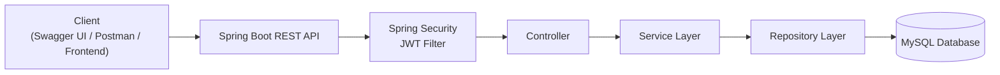
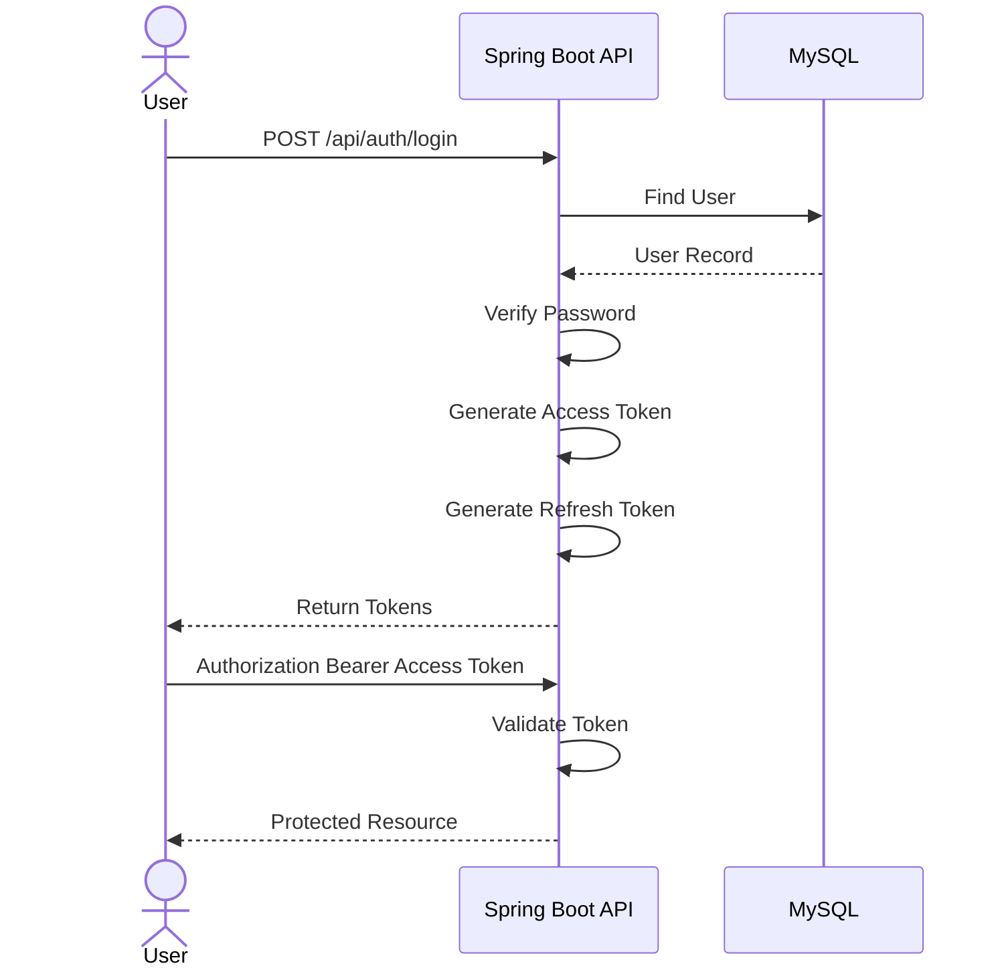
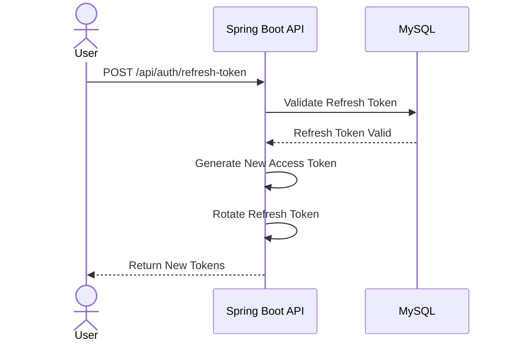
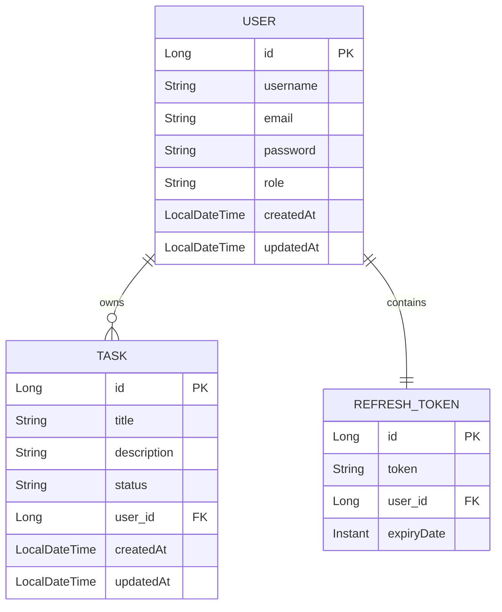

# 🚀 TaskFlow

> A Task Management System built with Spring Boot and secured using JWT Authentication and Refresh Token Authentication.
>
> Supports Role-Based Authorization, Pagination, Search, Filtering, Sorting, Swagger Documentation, and Docker Deployment.

---

## ✨ Features

### 🔐 Authentication

- User Registration
- User Login
- JWT Authentication
- Access Token
- Refresh Token
- Refresh Token Rotation
- Secure API Access

### 👤 User Management

- Get Current User Profile
- Get User By ID
- Get All Users (ADMIN)
- Delete User (ADMIN)

### ✅ Task Management

- Create Task
- Get Task By ID
- Update Task
- Delete Task
- Pagination
- Search by Title
- Filter by Status
- Sorting

### 🛡 Authorization

- Role-Based Access Control
  - USER
  - ADMIN
- Spring Security 6

### 📖 Documentation & DevOps

- Swagger / OpenAPI
- Docker
- Docker Compose
- Maven Wrapper

---

## 🚀 Advanced Features

✅ JWT Authentication

✅ Access Token Authentication

✅ Refresh Token Authentication

✅ Refresh Token Rotation

✅ Role-Based Authorization

✅ Pagination

✅ Search by Title

✅ Filter by Status

✅ Sorting

✅ Swagger/OpenAPI

✅ Docker & Docker Compose

✅ Audit Fields (`createdAt`, `updatedAt`)

---

## 🛠 Tech Stack

| Layer | Technologies |
|---------|-------------|
| Backend | Java 17, Spring Boot 3.5.6 |
| Security | Spring Security 6 |
| Database | MySQL 8 |
| ORM | Spring Data JPA, Hibernate |
| Authentication | JWT + Refresh Token |
| Documentation | Swagger / OpenAPI 3 |
| DevOps | Docker, Docker Compose |
| Build Tool | Maven |
| Utilities | Lombok, Jakarta Validation API |

---

## 🏛 System Architecture



---

## 🔐 Authentication Architecture

```text
auth
├── Login
├── Access Token (24 Hours)
├── Refresh Token (7 Days)
└── Refresh Endpoint
```

---

## 🔐 JWT Authentication Flow



---

## 🔄 Refresh Token Flow



---

## 🗄 Entity Relationship Diagram



---

## 📁 Project Structure

```text
taskflow/
├── screenshots/
├── src/
│
├── main/
│   ├── java/com/taskflow/
│   │   ├── config/
│   │   ├── controller/
│   │   ├── dto/
│   │   │   ├── request/
│   │   │   └── response/
│   │   ├── entity/
│   │   ├── exception/
│   │   ├── mapper/
│   │   ├── repository/
│   │   ├── security/
│   │   └── service/
│   │
│   └── resources/
│       └── application.properties
│
├── Dockerfile
├── docker-compose.yml
├── pom.xml
└── README.md
```

---

## ⚙️ Getting Started

### Prerequisites

- Java 17
- Maven 3.9+
- MySQL 8
- Docker (optional)

---

### Clone Repository

```bash
git clone https://github.com/huenguyenkim/Taskflow.git
```

```bash
cd Taskflow
```

---

### Create Database

```sql
CREATE DATABASE taskflow;
```

---

### Configure Application

```properties
spring.datasource.url=jdbc:mysql://localhost:3306/taskflow
spring.datasource.username=root
spring.datasource.password=your_password

spring.jpa.hibernate.ddl-auto=update

jwt.secret=your_secret_key
jwt.expiration=86400000
```

---

### Run Application

Windows:

```powershell
.\mvnw.cmd spring-boot:run
```

Linux / Mac:

```bash
./mvnw spring-boot:run
```

---

### Build Jar

```bash
./mvnw clean package
```

Run:

```bash
java -jar target/taskflow-0.0.1-SNAPSHOT.jar
```

---

## 🐳 Docker

### Build Docker Image

```bash
docker build -t taskflow .
```

### Run Docker Container

```bash
docker run -p 8080:8080 taskflow
```

---

## 🐳 Docker Compose

### Start Services

```bash
docker compose up -d
```

### Stop Services

```bash
docker compose down
```

---

## 📖 Swagger Documentation

After starting the application:

```text
http://localhost:8080/swagger-ui/index.html
```

---

## 🔗 Main Endpoints

### Authentication

| Method | Endpoint |
|----------|----------|
| POST | /api/auth/register |
| POST | /api/auth/login |
| POST | /api/auth/refresh-token |

### Users

| Method | Endpoint |
|----------|----------|
| GET | /api/users/profile |
| GET | /api/users |
| GET | /api/users/{id} |
| DELETE | /api/users/{id} |

### Tasks

| Method | Endpoint |
|----------|----------|
| POST | /api/tasks |
| GET | /api/tasks |
| GET | /api/tasks/{id} |
| PUT | /api/tasks/{id} |
| DELETE | /api/tasks/{id} |

---

## 🔍 Query Examples

### Pagination

```http
GET /api/tasks?page=0&size=5
```

### Search

```http
GET /api/tasks?keyword=swagger
```

### Filter

```http
GET /api/tasks?status=DONE
```

### Sort

```http
GET /api/tasks?sortBy=createdAt&direction=desc
```

### Combined Query

```http
GET /api/tasks?page=0&size=5&keyword=swagger&status=DONE&sortBy=createdAt&direction=desc
```

---

## 🔐 Login Example

### Request

```json
{
  "email": "admin@gmail.com",
  "password": "123456"
}
```

### Response

```json
{
  "accessToken": "...",
  "refreshToken": "...",
  "tokenType": "Bearer",
  "id": 1,
  "username": "admin",
  "email": "admin@gmail.com",
  "role": "ADMIN"
}
```

---

## 🔄 Refresh Token Example

### Request

```json
{
  "refreshToken": "8f9fc15d-d615-411d-862f-937e876623cf"
}
```

### Response

```json
{
  "accessToken": "...",
  "refreshToken": "...",
  "tokenType": "Bearer"
}
```

---

## 🖼 Screenshots

### Login with Access Token & Refresh Token

screenshots/login-with-refresh-token.png

### Refresh Token Authentication

screenshots/refresh-token-success.png

### Pagination

screenshots/pagination.png

### Search, Filter & Sort

screenshots/task-query.png

### Swagger UI

screenshots/swagger-ui.png

---

## ✅ Completed Features

- JWT Authentication
- Refresh Token Authentication
- Refresh Token Rotation
- User Registration
- User Login
- Role-Based Authorization
- User Management
- Task CRUD Operations
- Pagination
- Search by Title
- Filter by Status
- Sorting
- Swagger/OpenAPI Documentation
- Docker Support
- Docker Compose
- MySQL Integration
- Audit Fields

---

## 🔮 Future Improvements

- [ ] React Frontend (Vite + Tailwind CSS)
- [ ] Email Notification Service
- [ ] File Attachments
- [ ] Redis Caching
- [ ] CI/CD Pipeline (GitHub Actions)
- [ ] Kubernetes Deployment
- [ ] Dashboard & Analytics

---

## 👩‍💻 Author

**Nguyen Thi Kim Hue**

Java Backend Developer

- GitHub: https://github.com/huenguyenkim
- Repository: https://github.com/huenguyenkim/Taskflow
- Email: nguyenhue2612200398@gmail.com

---

## 📄 License

This project is licensed under the MIT License.
