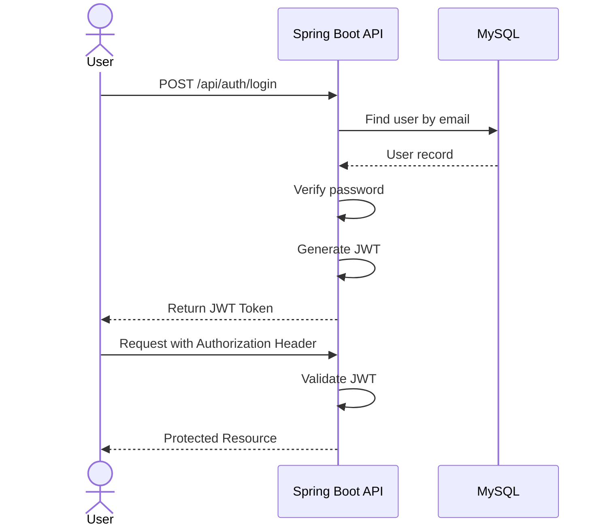
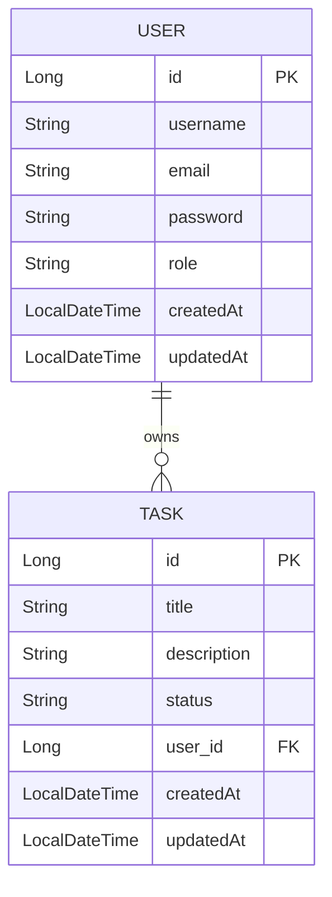

# 🚀 TaskFlow

> Task Management System built with **Spring Boot** and secured with **JWT Authentication**.
>
> Supports Role-Based Authorization, Pagination, Search, Filtering, Sorting, Swagger API Documentation, and Docker Deployment.

[API Docs (Swagger)](#-swagger-api-documentation) • [Screenshots](#-screenshots) • [Features](#-features)

---

# ✨ Features

## 🔐 Authentication

- User Registration
- User Login
- JWT Authentication
- Secure API Access

## 👤 User Management

- Get Current User Profile
- Get User By ID
- Get All Users (ADMIN)
- Delete User (ADMIN)

## ✅ Task Management

- Create Task
- Get Task By ID
- Update Task
- Delete Task
- Pagination
- Search by Title
- Filter by Status
- Sorting

## 🛡 Authorization

- Role-Based Access Control
  - `USER`
  - `ADMIN`
- Spring Security Integration

## 📖 Documentation & DevOps

- Swagger / OpenAPI Documentation
- Docker Support
- Docker Compose Support
- Maven Build Automation

---

# 🚀 Advanced Features

✅ JWT Authentication

✅ Role-Based Authorization

✅ Pagination

✅ Search by Title

✅ Filter by Status

✅ Sorting

✅ Swagger/OpenAPI

✅ Docker & Docker Compose

✅ Audit Fields (`createdAt`, `updatedAt`)

---

# 🛠 Tech Stack

| Layer | Technologies |
|---------|---------|
| Backend | Java 17, Spring Boot 3.5.6, Spring Security 6, Spring Data JPA, Hibernate, Maven |
| Database | MySQL 8 |
| Authentication | JWT (JSON Web Token) |
| Documentation | Swagger / OpenAPI 3 |
| DevOps | Docker, Docker Compose |
| Utilities | Lombok, Jakarta Validation API |

---

# 🏛 System Architecture


---

# 🔐 JWT Authentication Flow



---

# 🗄 Entity Relationship Diagram



---

# 📁 Project Structure

```text
taskflow/
├── screenshots/
├── src/
│   ├── main/
│   │   ├── java/com/taskflow/
│   │   │   ├── config/
│   │   │   ├── controller/
│   │   │   ├── dto/
│   │   │   ├── entity/
│   │   │   ├── exception/
│   │   │   ├── repository/
│   │   │   ├── security/
│   │   │   └── service/
│   │   └── resources/
│   │       └── application.properties
│   └── test/
├── Dockerfile
├── docker-compose.yml
├── pom.xml
└── README.md
```

---

# ⚙️ Getting Started

## Prerequisites

- Java 17
- Maven 3.9+
- MySQL 8 (or Docker)

---

## 1. Clone Repository

```bash
git clone https://github.com/huenguyenkim/Taskflow.git
```

```bash
cd Taskflow
```

---

## 2. Create Database

```sql
CREATE DATABASE taskflow;
```

---

## 3. Configure Application

`src/main/resources/application.properties`

```properties
spring.datasource.url=jdbc:mysql://localhost:3306/taskflow
spring.datasource.username=root
spring.datasource.password=your_password

spring.jpa.hibernate.ddl-auto=update

jwt.secret=your_secret_key
jwt.expiration=86400000
```

> ⚠️ Never commit real passwords or secrets to GitHub.

---

## 4. Run Application

Using Maven Wrapper:

```bash
./mvnw spring-boot:run
```

or:

```bash
mvn spring-boot:run
```

---

## 5. Build JAR

```bash
./mvnw clean package
```

Run:

```bash
java -jar target/taskflow-0.0.1-SNAPSHOT.jar
```

---

# 🐳 Docker

## Build Docker Image

```bash
docker build -t taskflow .
```

---

## Run Docker Container

```bash
docker run -p 8080:8080 \
-e SPRING_DATASOURCE_URL=jdbc:mysql://host.docker.internal:3306/taskflow \
-e SPRING_DATASOURCE_USERNAME=root \
-e SPRING_DATASOURCE_PASSWORD=your_password \
taskflow
```

---

# 🐳 Docker Compose

## Start Services

```bash
docker compose up -d
```

## View Running Containers

```bash
docker ps
```

## Stop Services

```bash
docker compose down
```

## Remove Volumes

```bash
docker compose down -v
```

---

# 📖 Swagger API Documentation

After starting the application:

```text
http://localhost:8080/swagger-ui/index.html
```

---

# 🔗 Main Endpoints

| Method | Endpoint | Access |
|----------|-----------|----------|
| POST | `/api/auth/register` | Public |
| POST | `/api/auth/login` | Public |
| GET | `/api/users/profile` | USER / ADMIN |
| GET | `/api/users` | ADMIN |
| GET | `/api/users/{id}` | ADMIN |
| DELETE | `/api/users/{id}` | ADMIN |
| POST | `/api/tasks` | USER / ADMIN |
| GET | `/api/tasks` | USER / ADMIN |
| GET | `/api/tasks/{id}` | USER / ADMIN |
| PUT | `/api/tasks/{id}` | USER / ADMIN |
| DELETE | `/api/tasks/{id}` | USER / ADMIN |

---

# 🔍 Task Query Examples

## Pagination

```http
GET /api/tasks?page=0&size=5
```

---

## Search

```http
GET /api/tasks?keyword=swagger
```

---

## Filter

```http
GET /api/tasks?status=DONE
```

---

## Sort

```http
GET /api/tasks?sortBy=createdAtttp
GET /api/tasks?page=0&size=5&status=DONE&keyword=swagger&sortBy=createdAt&direction=desc
```

---

# 🖼 Screenshots

## Swagger UI

```text
screenshots/swagger-ui.png
```

## JWT Authentication

```text
screenshots/login-success.png
```

## Task Management API

```text
screenshots/task-list.png
```

## Pagination, Search, Filter & Sort

```text
screenshots/pagination-search-filter-sort.png
```

## Docker Containers

```text
screenshots/docker-running.png
```

---

# ✅ Completed Features

- JWT Authentication
- User Registration
- User Login
- Role-Based Authorization
- User Management
- Task CRUD
- Pagination
- Search
- Filter
- Sorting
- Swagger Documentation
- Docker Support
- Docker Compose Support
- MySQL Integration
- Audit Fields

---

# 🔮 Future Improvements

- [ ] Refresh Token Authentication
- [ ] Email Notifications
- [ ] File Attachments
- [ ] Redis Caching
- [ ] React Frontend (Vite + React Router)
- [ ] CI/CD Pipeline (GitHub Actions)
- [ ] Kubernetes Deployment

---

# 👩‍💻 Author

**Nguyen Thi Kim Hue**

Backend Developer (Java / Spring Boot)

- GitHub: https://github.com/huenguyenkim
- Repository: https://github.com/huenguyenkim/Taskflow
- Email: nguyenhue2612200398@gmail.com

---

# 📄 License

This project is licensed under the MIT License.
