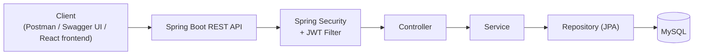
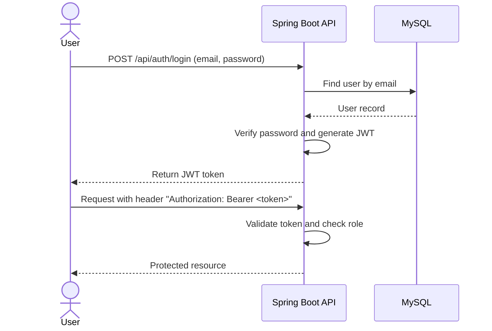
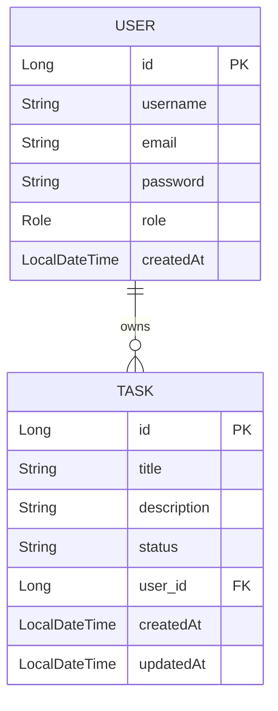

# 🚀 TaskFlow

> Task Management System built with **Spring Boot** and secured with **JWT Authentication**. Users can register, log in and manage their own tasks, while admins can manage all users.

[Live Demo](#) · [API Docs (Swagger)](#swagger-api-documentation) · [Screenshots](#screenshots)

---

## ✨ Features

**Authentication**
- User registration and login
- JWT authentication
- Secure API access

**User Management**
- Get current user profile
- Get user by ID
- Get all users (ADMIN)
- Delete user (ADMIN)

**Task Management**
- Create, view (all / by ID), update and delete tasks

**Authorization**
- Role-based access: `USER` and `ADMIN`
- Spring Security integration

**Documentation & DevOps**
- Swagger / OpenAPI interactive API testing
- Docker and Docker Compose support
- Maven build automation

---

## 🛠 Tech Stack

| Layer | Technologies |
|---|---|
| Backend | Java 17, Spring Boot 3.5.6, Spring Security 6, Spring Data JPA, Hibernate, Maven |
| Database | MySQL 8 |
| Authentication | JWT (JSON Web Token) |
| Documentation | Swagger / OpenAPI 3 |
| DevOps | Docker, Docker Compose |
| Utilities | Lombok, Jakarta Validation API |

---

## 🏛 System Architecture



---

## 🔐 JWT Authentication Flow



---

## 🗄 Entity Relationship Diagram

> Adjust the fields below to match your actual entities.



---

## 📁 Project Structure

```text
taskflow/
├── src/
│   ├── main/
│   │   ├── java/com/taskflow/
│   │   │   ├── config/        # Security, Swagger, JWT config
│   │   │   ├── controller/    # REST controllers
│   │   │   ├── dto/           # Request / response objects
│   │   │   ├── entity/        # JPA entities
│   │   │   ├── exception/     # Global exception handling
│   │   │   ├── repository/    # Spring Data JPA repositories
│   │   │   └── service/       # Business logic
│   │   └── resources/
│   │       └── application.properties
│   └── test/
├── Dockerfile
├── docker-compose.yml
├── pom.xml
└── README.md
```

---

## ⚙️ Getting Started

### Prerequisites
- Java 17
- Maven 3.9+
- MySQL 8 (or Docker)

### 1. Clone the repository

```bash
git clone https://github.com/<your-username>/taskflow.git
cd taskflow
```

### 2. Configure the database

```sql
CREATE DATABASE taskflow;
```

Edit `src/main/resources/application.properties`:

```properties
spring.datasource.url=jdbc:mysql://localhost:3306/taskflow
spring.datasource.username=root
spring.datasource.password=your_password
spring.jpa.hibernate.ddl-auto=update

jwt.secret=your_long_random_secret
jwt.expiration=86400000
```

> ⚠️ Never commit real passwords or secrets. Use environment variables or a `.env` file (listed in `.gitignore`) and provide a `.env.example` instead.

### 3. Run the application

```bash
./mvnw spring-boot:run
```

or, if Maven is installed:

```bash
mvn spring-boot:run
```

### 4. Build the JAR

```bash
./mvnw clean package
java -jar target/taskflow-0.0.1-SNAPSHOT.jar
```

---

## 🐳 Run with Docker

### Docker Compose (recommended)

```bash
docker compose up -d      # start app + database
docker ps                 # view running containers
docker compose down       # stop services
docker compose down -v    # stop and remove volumes
```

### Docker only

```bash
docker build -t taskflow .

docker run -p 8080:8080 \
  -e SPRING_DATASOURCE_URL=jdbc:mysql://host.docker.internal:3306/taskflow \
  -e SPRING_DATASOURCE_USERNAME=root \
  -e SPRING_DATASOURCE_PASSWORD=your_password \
  taskflow
```

---

## 📖 Swagger API Documentation

After starting the application, open:

```text
http://localhost:8080/swagger-ui/index.html
```

### Demo accounts

| Role | Email | Password |
|---|---|---|
| ADMIN | `admin@example.com` | `<your-password>` |
| USER | `user@example.com` | `<your-password>` |

### Main endpoints

| Method | Endpoint | Access | Description |
|---|---|---|---|
| POST | `/api/auth/register` | Public | Register a new user |
| POST | `/api/auth/login` | Public | Log in and receive a JWT |
| GET | `/api/users/me` | USER / ADMIN | Current user profile |
| GET | `/api/users` | ADMIN | List all users |
| DELETE | `/api/users/{id}` | ADMIN | Delete a user |
| POST | `/api/tasks` | USER / ADMIN | Create a task |
| GET | `/api/tasks` | USER / ADMIN | List tasks |
| GET | `/api/tasks/{id}` | USER / ADMIN | Get a task by ID |
| PUT | `/api/tasks/{id}` | USER / ADMIN | Update a task |
| DELETE | `/api/tasks/{id}` | USER / ADMIN | Delete a task |

> Update the paths above to match your controllers.

---

## 🖼 Screenshots

| Swagger UI | Login returns JWT | Task list |
|---|---|---|
|  |  |  |

---

## 🔮 Future Improvements

- [ ] Refresh token authentication (access token + refresh token flow)
- [ ] Pagination, search and filtering
- [ ] Email notifications
- [ ] File attachments
- [ ] Redis caching
- [ ] React frontend
- [ ] CI/CD pipeline (GitHub Actions)
- [ ] Kubernetes deployment
- [ ] Audit fields (`createdAt`, `updatedAt`) on all entities

---

## 👩‍💻 Author

**Nguyen Thi Kim Hue**
Backend developer (Java / Spring Boot)

- GitHub: https://github.com/huenguyenkim/Taskflow.git
- Email: nguyenhue2612200398@gmail.com

---

## 📄 License

This project is licensed under the [MIT License](LICENSE).
